# Integration of the Sparrow Optimization Algorithm with Butterfly Search, improvement of Sparrow, and SSA, with MATLAB code attached

The inspiration of the Butterfly Algorithm's global update method led to the integration of the unique sense and individual perception capabilities of the Butterfly Algorithm into the Sparrow Algorithm, enhancing the global search capability during the discoverer position update phase in the Sparrow Algorithm and improving its optimization ability.

Detailed Explanation:
After studying the Sparrow Algorithm, the vast majority of authors have improved or replaced the position update formula for the discoverer phase, indicating that the position update capability of the Sparrow Algorithm in the discoverer phase is indeed poor! Therefore, in future improvements to the Sparrow Algorithm, one could also consider this aspect for enhancement!
The improvement strategy adopted in this article is as follows:
1. Use a cube chaos map to initialize particles.
Choose a cubic chaos map with better uniformity to initialize the Sparrow population. The formula is as follows:
\n        \n  
2. Incorporate the Butterfly Algorithm search strategy into the discoverer phase when R2 <= ST. The formula is as follows:
\n        \n      f is the Sparrow's sense of food, i.e., how strong the taste of food can be detected by other Sparrows; c is the Sparrow's sensory modality; I is the stimulus intensity; a is an exponent dependent on the modality, which explains the absorption of different degrees of food taste. During the discoverer search phase, Sparrows move towards the food.
3. Triangle wandering strategy
In the discoverer phase of the Sparrow Algorithm, when R2 > ST, add the triangle wandering strategy. After Sparrows find food, they do not need to directly approach it but can wander around it, increasing Sparrows' randomness. The formula for the triangle wandering strategy is as follows:
\n        \n      \n        \n      \n        \n      \n        \n      \n        \n
Results Display
In the CEC2005 function, a population of 50 and an iteration count of 1000 were used. The Sparrow Search Algorithm Combining Butterfly Search and Triangle Walk (BTSSA), the Sparrow Search Algorithm (SSA), and the Dung Beetle Optimization Algorithm (DBO) were compared. The results are as follows:
\n        \n      \n        \n      \n        \n      \n        \n      \n        \n      \n        \n      \n        \n      \n        \n      \n        \n      \n        \n  
It is evident that the Butterfly Search and Triangular Wandering Algorithm (BTSSA) has performed exceptionally well on CEC2005, outperforming the most popular DBO algorithm. Moreover, the proposed algorithm in this paper does not increase computational complexity or add many redundant strategies such as backpropagation, greedy strategies, etc.
Code display

## Images

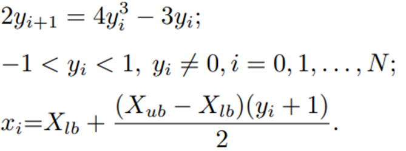
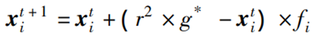
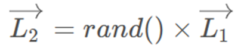
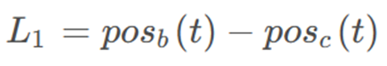
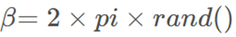
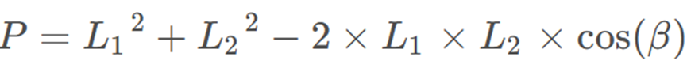
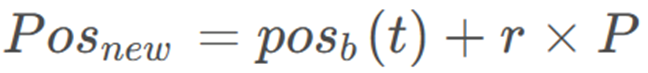
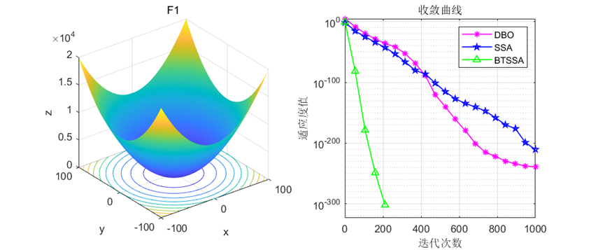
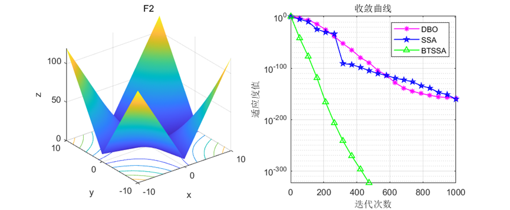
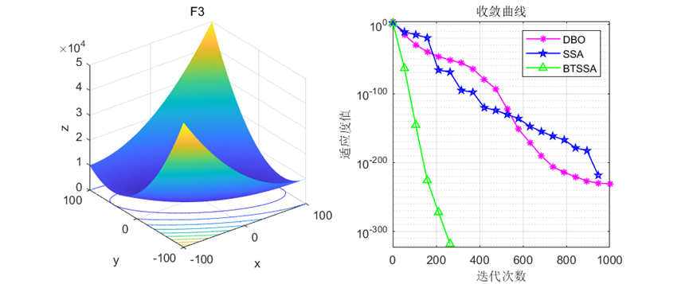
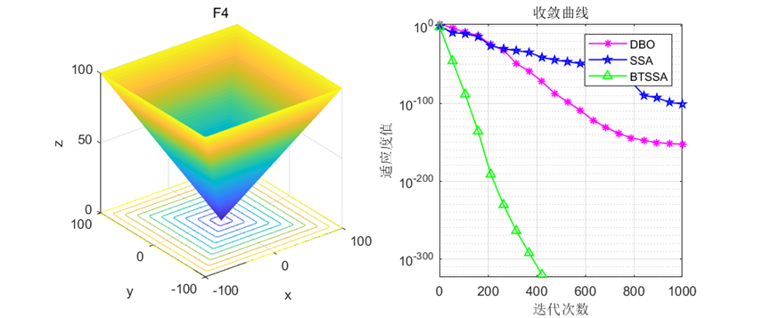
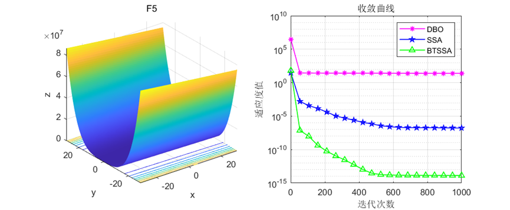
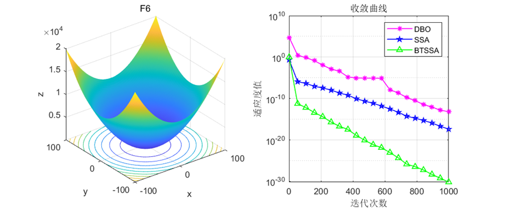
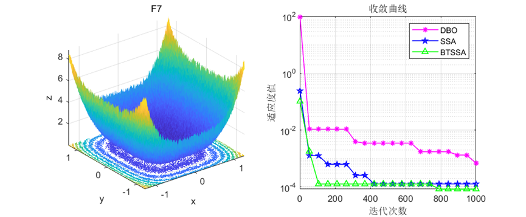
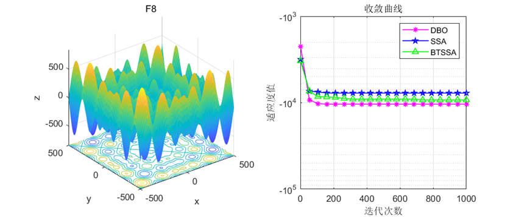
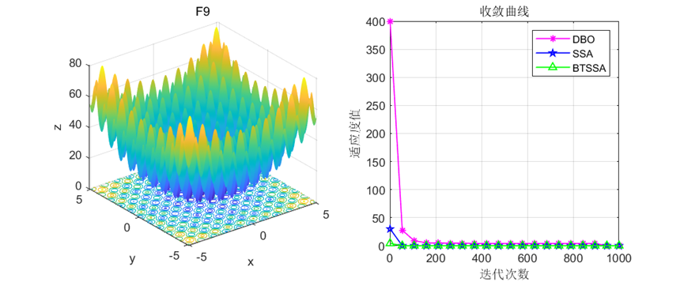
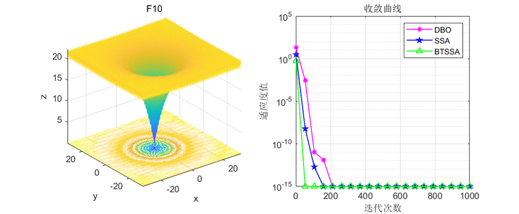

<!-- PAYMENT_BLOCK -->

## Get this dataset

- Payment link (Stripe): [Buy now](https://buy.stripe.com/3cs8yP7sY87d0vu9AB)
- Payment QR code: 

<!-- /PAYMENT_BLOCK -->
